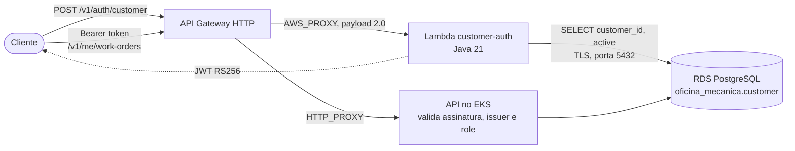

# Oficina Mecânica — autenticação do cliente por CPF

Função serverless que autentica o cliente da oficina pelo CPF e devolve o JWT com que ele consome as
rotas protegidas da API (`/v1/me/work-orders`). Ela:

1. valida o CPF (formato e dígitos verificadores);
2. consulta no RDS se existe cliente com aquele CPF e se ele está ativo;
3. emite um JWT RS256 assinado com a mesma chave da API, com o id do cliente em `sub` e o papel
   `CUSTOMER` em `groups`.

A decisão e as alternativas descartadas estão no
[ADR-0007](../../docs/adr/0007-autenticacao-do-cliente-por-cpf-em-funcao-serverless.md).

## Arquitetura



A função roda dentro da VPC, nas mesmas subnets do cluster, com um security group cuja única saída é
o Postgres. Ela não acessa a internet e por isso dispensa NAT.

Internamente segue o mesmo hexágono da API:

| Camada | Classe | Papel |
|---|---|---|
| domínio | `Cpf`, `Customer` | regra do dígito verificador; cliente inativo não autentica |
| aplicação | `CustomerAuthenticationService` | orquestra validação, consulta e emissão |
| porta de entrada | `CustomerAuthHandler` | evento do API Gateway, respostas no formato `ApiErrorResponseDto` |
| portas de saída | `JdbcCustomerLookupAdapter`, `RsaJwtCustomerTokenAdapter` | RDS e assinatura do token |

## Contrato

```http
POST /v1/auth/customer
Content-Type: application/json

{"cpf": "529.982.247-25"}
```

| Status | `code` | Quando |
|---|---|---|
| 200 | — | `{"token", "customerId", "role": "CUSTOMER", "expiresIn": 3600}` |
| 400 | `INVALID_REQUEST` | corpo ausente, JSON inválido ou sem `cpf` |
| 400 | `INVALID_CPF` | CPF com tamanho ou dígito verificador inválido |
| 401 | `CUSTOMER_NOT_AUTHORIZED` | CPF sem cadastro **ou** cliente inativo (mesma resposta, de propósito) |
| 500 | `INTERNAL_ERROR` | banco inalcançável ou falha inesperada; a causa fica só no log |

Com o token:

```shell
curl -H "Authorization: Bearer $TOKEN" "$API_URL/v1/me/work-orders"
```

O Swagger da API documenta as rotas `/v1/me/work-orders` na tag *Customer — My Work Orders*.

## Tecnologias

Java 21 (runtime `java21` da Lambda), AWS Lambda Java Core/Events, driver JDBC do PostgreSQL,
Nimbus JOSE + JWT, Jackson, JUnit 5, Mockito, Testcontainers e JaCoCo (gate de 80% de linhas).
Infraestrutura em Terraform; entrega pelo GitHub Actions.

## Executando os testes

```shell
./mvnw verify          # unitários + gate de cobertura + JAR em target/customer-auth.jar
./mvnw verify -Pitest  # inclui o teste contra Postgres real (requer Docker)
```

## Configuração

Tudo chega por variável de ambiente, preenchida pelo Terraform:

| Variável | Obrigatória | Default | Descrição |
|---|---|---|---|
| `DB_HOST` | sim | — | endereço do RDS |
| `DB_PORT` | não | `5432` | |
| `DB_NAME` | sim | — | |
| `DB_USERNAME` / `DB_PASSWORD` | sim | — | |
| `DB_SSLMODE` | não | `require` | o RDS recusa conexão em claro |
| `JWT_PRIVATE_KEY_B64` | sim | — | PEM PKCS#8 em base64; o mesmo secret `JWT_PRIVATE_KEY_B64` da API |
| `JWT_ISSUER` | não | `oficina-api` | precisa ser igual ao `JWT_ISSUER` da API |
| `JWT_EXPIRATION_MINUTES` | não | `60` | validade do token do cliente |

## Deploy

A stack da plataforma (`infra/terraform`) precisa estar aplicada: a função lê dela a rede, o banco e o
id do API Gateway, pelo state remoto.

**Pela pipeline** (`.github/workflows/lambda.yml`): o PR roda testes e `terraform validate`; o merge
na `main` empacota, aplica a stack e faz um smoke test pelo API Gateway. Usa os secrets
`AWS_ACCESS_KEY_ID`, `AWS_SECRET_ACCESS_KEY`, `AWS_SESSION_TOKEN` e `JWT_PRIVATE_KEY_B64`.

**Da máquina do operador**, com a sessão do lab ativa:

```shell
./mvnw package
cd terraform
export TF_VAR_jwt_private_key_b64="$(base64 < ../../../.local-jwt/privateKey.pem | tr -d '\n')"
terraform init
terraform apply
curl -s -X POST "$(terraform output -raw customer_auth_url)" \
  -H 'Content-Type: application/json' -d '{"cpf":"529.982.247-25"}'
```

Use a chave do ambiente que a API está usando — com outra, a função emite tokens que a API recusa
com 401.

## Logs

Uma linha JSON por evento no log group `/aws/lambda/oficina-mecanica-customer-auth`, com `requestId`
para correlacionar com o access log do API Gateway (`/aws/apigateway/oficina-mecanica`). O CPF nunca
aparece no log; o motivo de uma recusa, sim (`reason`: `invalid-cpf`, `not-found`, `inactive`).
